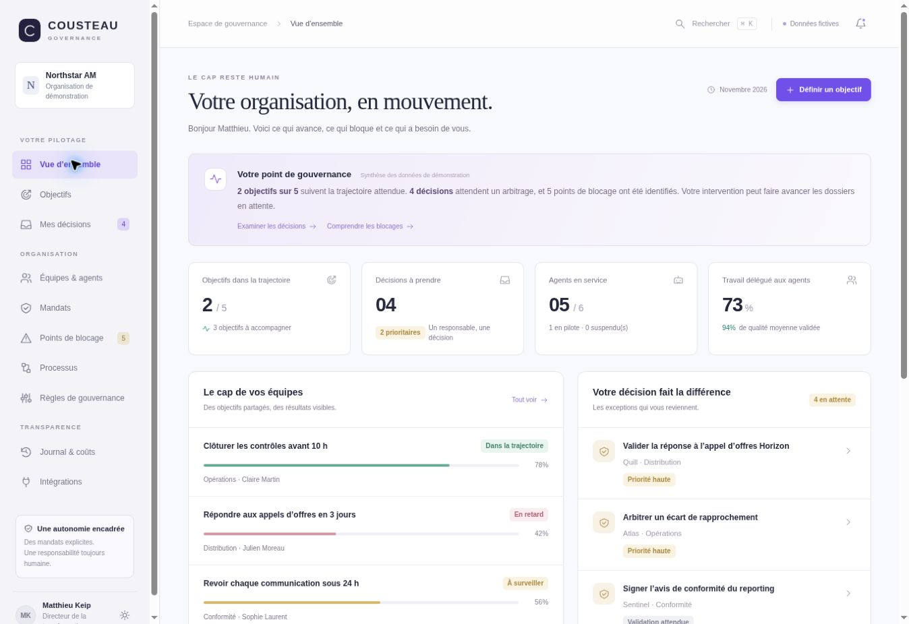
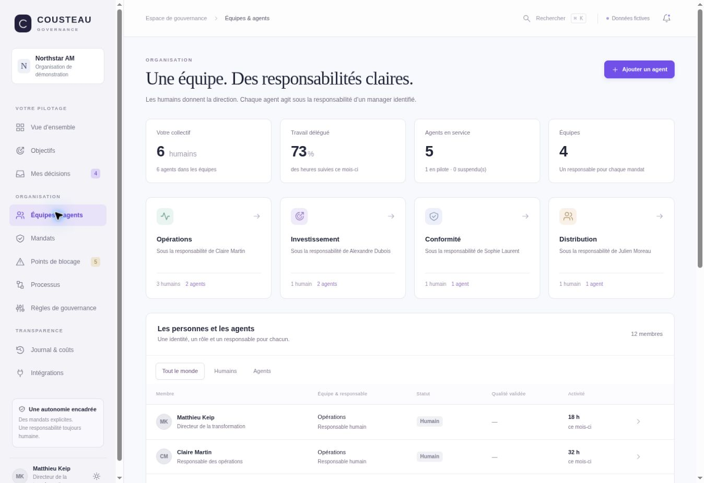
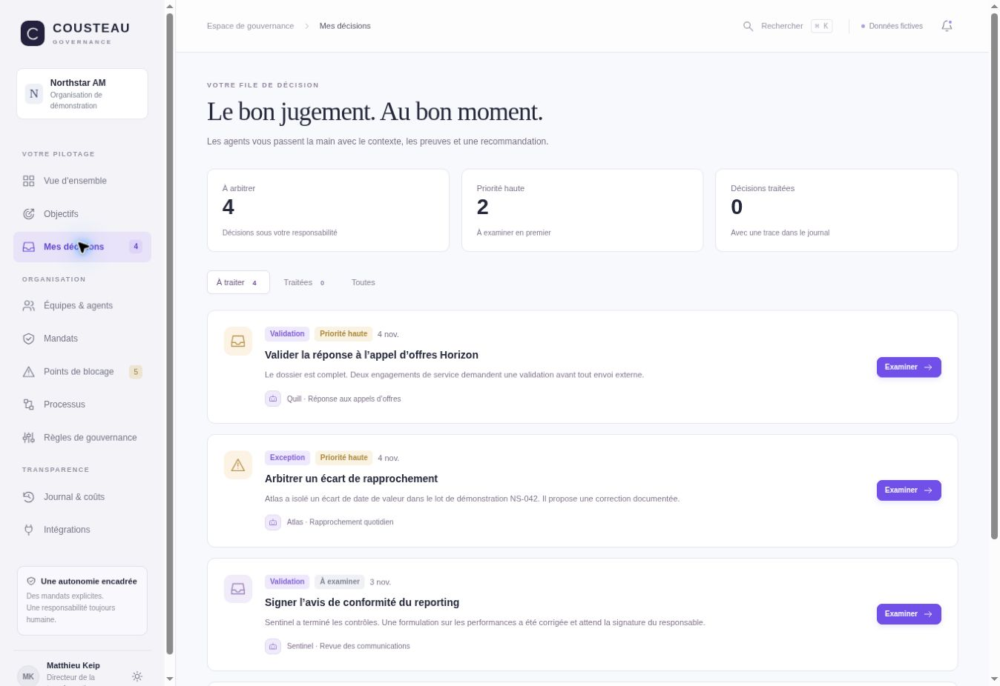
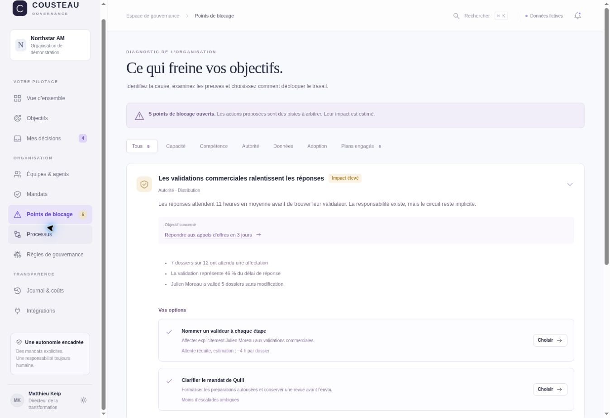
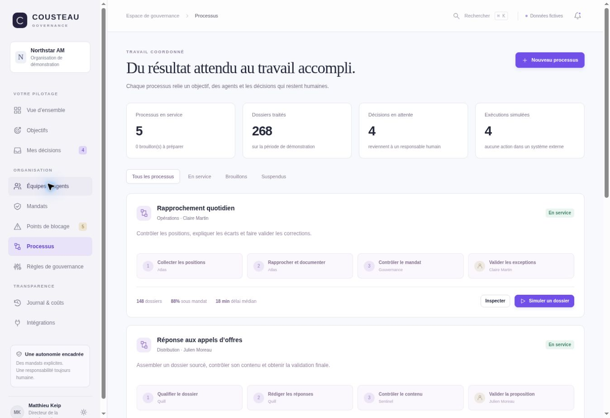

# Cousteau Governance

**Le cap reste humain.** Un cockpit de gouvernance pour organiser des équipes mixtes, déléguer aux agents, arbitrer les exceptions et relier le travail aux objectifs.

[Ouvrir l’application déployée](https://alto-govern-matthieu.keip.chatgpt.site) · [Guide produit](docs/product.md) · [Architecture](docs/architecture.md) · [Feuille de route](docs/roadmap.md)



## Ce que contient cette version

Un démonstrateur interactif en français, inspiré des principes de gouvernance de Wand OS, avec une identité et un scénario propres. L’organisation **Northstar AM**, ses dossiers, ses coûts et ses résultats sont fictifs.

Dix écrans couvrent le pilotage, les objectifs, les décisions, les équipes et agents, les mandats, les points de blocage, les processus, les règles, le journal et les intégrations cibles. Les modifications sont conservées dans le navigateur ; les parcours de création, d’arbitrage et de simulation sont fonctionnels localement.

**Temporal et Mastra sont les cibles d’intégration. Ils ne sont pas connectés dans cette version.**

## Captures

| Organisation | Décisions |
| --- | --- |
|  |  |

| Points de blocage | Processus |
| --- | --- |
|  |  |

## Lancer localement

Aucune dépendance d’exécution à installer. Avec Python 3, depuis la racine du projet :

```sh
python3 -m http.server 4173 --directory dist
```

Ouvrir `http://localhost:4173`. Le chargement des modules JavaScript nécessite un serveur HTTP ; l’ouverture directe de `index.html` en `file://` n’est pas prise en charge.

## Vérifier le projet

Avec une version récente de Node.js :

```sh
node tests/domain.mjs
node tests/render.mjs
```

Les tests métier couvrent l’approbation unique, le refus, la suspension, l’expiration et la modification des mandats, les outils interdits, le budget, les actions correctives et la persistance. Les tests de rendu couvrent les huit vues modulaires et l’échappement des contenus saisis. La vérification visuelle et des interactions reste complémentaire.

## Structure

| Chemin | Contenu |
| --- | --- |
| `dist/index.html` | Entrée de l’application |
| `dist/app.js` | Navigation, tableaux de bord, modales et interactions communes |
| `dist/modules/store.js` | Scénario, état local, simulations et contrôles prédéfinis |
| `dist/modules/governance.js` | Objectifs, décisions, blocages et règles |
| `dist/modules/organization.js` | Organisation, mandats, processus et intégrations cibles |
| `dist/modules/ui.js` | Composants et échappement HTML |
| `dist/*.css` | Styles et adaptation aux écrans étroits |
| `tests/` | Vérifications métier et rendu |
| `docs/` | Architecture, guide produit, feuille de route et captures |

## Déployer

Publier le contenu de `dist/` sur un hébergeur statique. La navigation utilise des fragments d’URL (`#goals`, `#decisions`, etc.) : aucune réécriture serveur n’est nécessaire. Le déploiement Sites existant conserve son URL historique ; son identité figure dans `.openai/hosting.json`.

La donnée de démonstration est enregistrée dans le `localStorage` du navigateur. La clé historique `alto-govern-demo-v1` peut être conservée lors d’un renommage pour préserver les sessions existantes. L’export JSON permet de conserver un instantané ; la réinitialisation restaure le scénario initial.

## Limites à connaître

- Aucune exécution externe, donnée de marché réelle, connexion métier, transaction ou appel de modèle.
- Aucun backend, aucune authentification propre à l’application, aucun partage d’état entre utilisateurs. Les éventuelles restrictions d’accès de l’hébergement sont distinctes du prototype.
- Les contrôles dans le navigateur illustrent la gouvernance ; ils ne forment pas une frontière de sécurité.
- Le journal local est modifiable et réinitialisable. Il n’est ni immuable, ni signé, ni un registre d’audit de production.
- Seuls les contrôles prédéfinis ont une logique exécutable. Une nouvelle règle rédigée en langage naturel reste déclarative, même si son statut est changé dans l’interface.
- Les impacts proposés sont estimés ; engager un plan d’action ne transforme pas son bénéfice attendu en résultat acquis.
- Les contrats Temporal / Mastra présentés et exportés sont illustratifs, sans transport ni connecteur implémenté.

Le passage à un produit opérationnel est décrit dans la [feuille de route](docs/roadmap.md).
