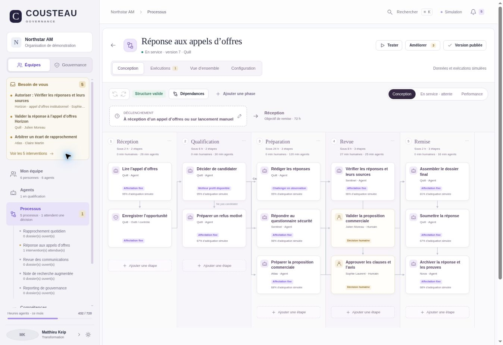
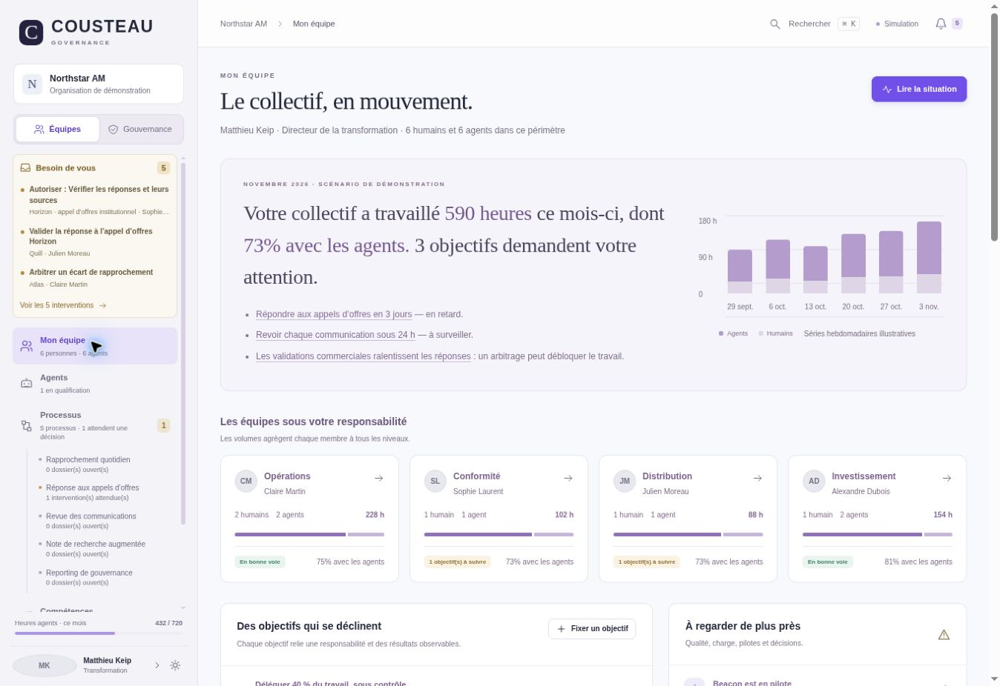
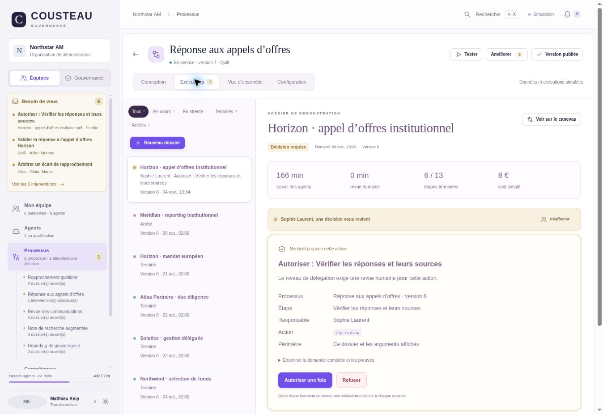
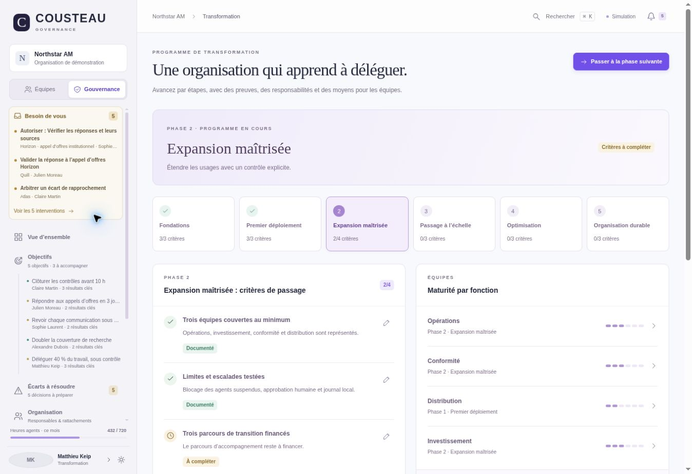
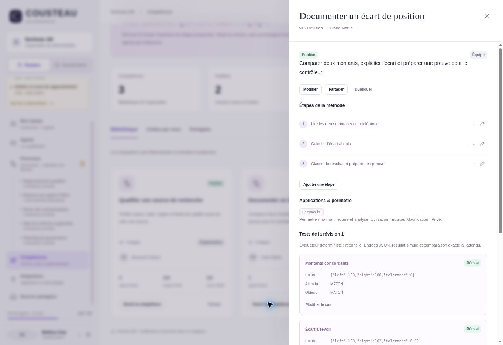

# Cousteau Governance

**Le cockpit humain d’une organisation d’agents.** Processus, responsabilités, interventions, compétences et politiques dans deux espaces : **Équipes** et **Gouvernance**.

[Application publique](https://alto-govern-matthieu.keip.chatgpt.site) · [Inventaire Wand OS / Cousteau](docs/wand-feature-parity.md) · [Guide produit](docs/product.md) · [Architecture](docs/architecture.md) · [Feuille de route](docs/roadmap.md)



Cette version 2 reprend les parcours observables de la démonstration publique de **Wand OS** (Teams et Governance) dans une interface Cousteau en français. Le code est une réimplémentation indépendante ; aucun code propriétaire Wand n’est inclus. Les marques, textes métier, données et styles ont été adaptés à l’organisation fictive Northstar AM.

> C’est un démonstrateur interactif persistant dans le navigateur. Temporal et Mastra sont les moteurs cibles, **pas des intégrations actives**. Les données, métriques, modèles, connexions et exécutions sont simulés. Il ne s’agit pas d’une reproduction du backend privé de Wand.

## Parcours disponibles

| Espace | Ce que l’on peut faire |
| --- | --- |
| Panneau gauche | Voir les dossiers qui attendent une décision, le responsable, l’état des processus et les objectifs ; ouvrir directement le contexte |
| Mon équipe | Explorer les sous-équipes, volumes humains/agents, cascades d’objectifs, retards, points d’attention et tableau hiérarchique |
| Processus | Décrire un résultat, choisir un modèle, modifier phases/étapes/dépendances/branches, affecter un humain ou un agent, comparer et publier des versions |
| Exécutions | Lancer un dossier ou tester le brouillon, suivre chaque étape, consulter les preuves, approuver/refuser/réaffecter, conserver l’instantané de départ |
| Agents | Créer ou recruter un profil, qualifier, tester, passer en pilote puis en service, partager et suspendre |
| Compétences | Définir étapes et cas de tests, publier une version, inscrire et certifier des apprenants humains ou agents |
| Intégrations | Configurer un périmètre, tester, demander une revue, autoriser ou révoquer une connexion simulée |
| Objectifs et écarts | Décliner un objectif, éditer les résultats clés, relier les processus, examiner les preuves et traiter les causes proposées |
| Organisation et transformation | Modifier les rattachements, suivre les phases de transformation et documenter les critères de passage |
| Politiques et sécurité | Définir blocage/revue/journalisation, tester les contrôles typés, traiter les événements et revoir les accès |
| Coûts et administration | Examiner budgets et hypothèses de valeur, configurer les rôles, leurs plafonds et le catalogue de modèles |
| Traçabilité | Consulter les décisions, les changements et leurs motifs ; exporter l’espace et le journal local |

Les différences et limites sont détaillées fonction par fonction dans l’[inventaire de couverture](docs/wand-feature-parity.md). Le nombre d’écrans ne vaut pas preuve d’équivalence opérationnelle.

## Captures

| Mon équipe | Exécutions et interventions |
| --- | --- |
|  |  |

| Transformation | Compétences |
| --- | --- |
|  |  |

## Lancer localement

Aucune dépendance JavaScript externe et aucune compilation.

```bash
python3 -m http.server 4173 --directory dist
```

Ouvrir `http://localhost:4173/`. Le premier écran est le catalogue de processus. Dans le menu gauche, ouvrir **Réponse aux appels d’offres** pour son designer à cinq phases et treize étapes.

## Vérifier

Node.js 24 est utilisé dans la CI. Les tests ne contactent aucun service externe.

```bash
npm test
```

Sept suites couvrent les règles métier, rendu et échappement, intégrité du graphe, versions, approbations successives, autorité du responsable, demandes périmées, révocation, qualification, tests/certification des compétences, hiérarchie, politique typée, migration, réinitialisation et espace de travail.

Les captures et parcours testés dans le navigateur sont décrits dans [design-qa.md](design-qa.md).

## Structure

| Chemin | Responsabilité |
| --- | --- |
| `dist/app.js` | Navigation OS, file d’interventions, recherche et fenêtres |
| `dist/modules/store.js` | État persistant, socle métier, mandats, décisions et audit local |
| `dist/modules/teams.js` | Mon équipe, hiérarchie, agrégats et objectifs |
| `dist/modules/workflows.js`, `workflow-store.js` | Designer, graphe, versions et moteur déterministe de dossiers |
| `dist/modules/capabilities.js`, `capabilities-store.js` | Agents, compétences, apprentissage et applications |
| `dist/modules/governance.js`, `governance-plus.js` | Objectifs, écarts, politiques, organisation, transformation et administration |
| `dist/modules/workspace.js` | Identités de démonstration, sources et interventions ; atelier agent secondaire |
| `CONTRACT.md` | Contrats cibles de gouvernance, à raccorder côté serveur |
| `tests/` | Sept suites locales |
| `docs/` | Documentation, inventaire et captures |

## Limites opérationnelles

- État propre au navigateur, sans backend partagé, authentification ni isolation multi-organisation.
- Aucun appel LLM, OAuth, envoi de message, ordre financier ou effet externe.
- Les rôles administrables illustrent un plafond ; ils ne constituent pas un moteur RBAC global. Les contrôles réellement appliqués dans la simulation sont précisés dans l’architecture.
- Journal modifiable localement ; aucune garantie d’immutabilité, de signature ou de conservation réglementaire.
- Prévisions, scores d’adéquation, coûts, tests agents et gains sont fictifs et explicitement signalés.
- La publication d’un processus crée une version locale. Le déploiement de ce site publie l’interface, sans déployer un worker Temporal ou Mastra.

[Architecture cible Temporal + Mastra](docs/architecture.md) · [Critères d’un pilote opérationnel](docs/roadmap.md)

Licence du code original de ce dépôt : [Apache-2.0](LICENSE).
