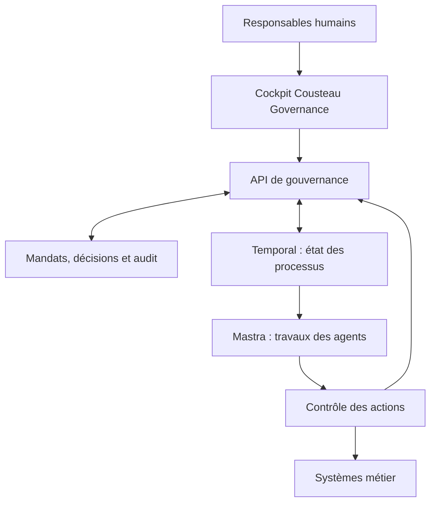

# Architecture de Cousteau Governance

Ce document décrit le démonstrateur de l’organisation partagée **Teams / Governance**, puis l’architecture cible. Les parcours reconstruits à partir de l’expérience observable de Wand OS utilisent une implémentation indépendante. Aucun moteur, code privé, compte ou service Wand n’est intégré. Les composants et interfaces de la cible sont des propositions de conception ; ils ne sont pas déployés dans cette version.

## 1. Responsabilité du produit

Cousteau Governance porte les décisions humaines : qui est responsable, quel mandat est accordé, quelles limites s’appliquent, qui tranche une exception et quelles preuves justifient le résultat. Le manager agit sur des objets métier reliés : organisation, objectif, mandat, processus, demande de décision et résultat.

Temporal et Mastra restent les choix d’exécution envisagés. La séparation proposée est explicite : **Temporal conserve le déroulement durable du processus ; Mastra réalise les travaux agentiques ; Cousteau Governance détient les mandats et les décisions humaines.**

## 2. Architecture livrée

| Sujet | Implémentation actuelle |
| --- | --- |
| Interface | HTML, CSS et modules JavaScript natifs, sans dépendance de rendu |
| Navigation | Fragments d’URL et rendu côté navigateur |
| État métier | Objet JavaScript et `localStorage` |
| Données initiales | Organisation fictive Northstar AM, complétée par un catalogue d’agents, des compétences, des applications, des rôles et un historique de processus simulé |
| Exécution | Simulations locales dans `store.js` et `workflow-store.js`, sans outil ni modèle distant |
| Décisions | Mise à jour locale de la demande, du dossier simulé et du journal |
| Contrôles | Conditions prédéfinies : responsable, statut, étape de qualification, autonomie, échéance, accès approuvés, outils et budget ; vérifications de version avant reprise |
| Compétences | Méthodes versionnées, cas de test déterministes, revue avant publication et évaluation avant certification fictive |
| Connecteurs | Configurations de catalogue et sur mesure, périmètres, tests de schéma et approbations simulés ; aucun secret ni transport réseau |
| Audit | Liste locale exportable, modifiable et réinitialisable |
| Utilisateurs | Personas et contrôles de scénario côté navigateur ; aucun contrôle d’autorisation serveur |

Les mutations passent normalement par `update()`, qui clone l’état, applique la modification, ajoute une trace, persiste et notifie le rendu. Ce mécanisme améliore la cohérence des parcours ; il ne protège pas contre une modification directe du navigateur.

Une simulation crée un dossier et ses événements. Si une étape humaine, un pilote ou un niveau d’autonomie l’exige, elle crée une demande de décision. Une approbation ou un refus met à jour l’état du dossier concerné. Les simulations restent une représentation simplifiée du travail réel.

### Modules effectifs

| Fichier | Responsabilité livrée |
| --- | --- |
| `dist/app.js` | Coque, navigation, rendu des vues, délégation des actions, panneaux, formulaires, recherche et notifications |
| `dist/modules/ui.js` | Échappement HTML, icônes, badges, avatars, barres de progression et formats numériques |
| `dist/modules/store.js` | État partagé, chargement et sauvegarde locale, journal des mutations, jeu initial, simulation historique et décisions |
| `dist/modules/organization.js` | Registre de base, fiches et mandats, ancienne vue de processus et contrats d’intégration exportables |
| `dist/modules/governance.js` | Objectifs, décisions, blocages et politiques |
| `dist/modules/workspace.js` | Personas, espaces de travail, conversations et résultats simulés, contexte, connaissances, tâches et propositions de méthode |
| `dist/modules/workflow-store.js` | Modèle du studio, brouillons et versions publiées, validation du graphe, historique d’édition, simulations et demandes d’intervention |
| `dist/modules/workflows.js` | Carte des phases et tâches, vues conception/exécution/performance/configuration, affectations, approbations et propositions d’amélioration |
| `dist/modules/capabilities-store.js` | Catalogue, profils de qualification, compétences, évaluations, certifications, périmètres de partage et connexions fictives |
| `dist/modules/capabilities.js` | Vues agents de l’équipe, bibliothèque de compétences et applications ; formulaires et actions persistantes de ces parcours |
| `dist/modules/governance-plus.js` | Hiérarchie des équipes, sécurité, administration, rôles, modèles déclarés, transformation et coûts |
| `dist/styles.css` et feuilles de domaine | Styles de la coque, du registre, de la gouvernance, du studio, des capacités et de l’espace de travail |

Les initialiseurs de domaine complètent l’état existant sans remplacer les données déjà présentes. L’initialisation des capacités crée les profils des agents du registre ; l’espace de travail ajoute leur configuration et leurs fils ; le studio reprend les processus du registre. Ces extensions sont persistées par le store lorsqu’elles sont initialisées ou modifiées.

### État partagé et frontières locales

| Emplacement | Objets principaux | Règle de cohérence |
| --- | --- | --- |
| `state.agents` | Humains et agents, manager, équipe, statut, mandat, compétences déclarées | Un recrutement ajoute un acteur au même registre que les équipes et les processus |
| `state.goals`, `policies`, `gaps` | Objectifs, règles et blocages | Les plans retenus et les changements restent traçables sans créer automatiquement un gain réel |
| `state.decisions`, `runs` | Décisions et dossiers du premier scénario | Une demande traitée ne peut pas être rejouée ; les reprises relisent les contrôles applicables |
| `state.workspace` | Persona, conversations, connaissances, tâches, configurations et propositions | Les réponses et pièces sont locales ; les tâches annoncées comme planifiées ne s’exécutent pas en arrière-plan |
| `state.studio.processes` | Brouillon, version publiée, historique d’édition et propositions | Les modifications du brouillon n’altèrent pas le snapshot d’une exécution existante |
| `state.studio.runs` | Snapshot, étapes, traces, mesures et demande humaine en cours | Une demande porte un identifiant et un jeton de version ; la reprise revalide contexte et acteur |
| `state.studio.grants` | Accords réutilisables de portée limitée | Corrélation avec processus, étape, agent, action, mandat et politiques ; aucune suppression d’une étape humaine obligatoire |
| `state.capabilities.profiles` | Qualification, tests, pilote, partage et applications requises | Qualification et tests ne permettent pas d’exécuter un processus ; une suspension ou un accès révoqué bloque la progression |
| `state.capabilities.skills` | Méthode, version, révision, tests, publication, apprenants et certificats | Une modification invalide les tests et remet les certifications en formation ; la révision évaluée doit correspondre à celle publiée |
| `state.capabilities.connections` | Outils, périmètres, propriétaire, état, révision et approbation | Disponible uniquement si `status === 'connected'`, `reviewed === true` et `testedRevision === revision` |
| `state.governancePlus` | Rôles, affectations, modèles déclarés, revues et événements | Les rôles et politiques sont des paramètres du scénario, sans garantie de contrôle externe |

Les décisions historiques et celles du studio restent deux structures locales, présentées par leurs vues et adaptateurs respectifs. Il ne faut pas traiter ce stockage comme un modèle transactionnel unifié de production. De même, les compétences déclarées sur un acteur décrivent son profil ; l’état de certification de la révision courante est porté par `capabilities.skills[].learners`.

### Machines d’état des capacités

Un agent créé depuis le catalogue passe par `qualification → testing → pilot → production`. Les tests vérifient une configuration locale et ses accès ; ils ne mesurent ni intelligence ni précision. Le passage au pilote exige les tests de la révision courante. La production exige un cas pilote et une revue humaine dans l’interface. Le statut historique `agent.status` reste compatible avec les vues précédentes ; `capabilities.profiles[agentId].stage` précise la qualification.

Une compétence commence en `draft`. Les tests comparent une entrée JSON à un résultat déterministe (`sources`, `reconcile` ou `complete`) et conservent `testedRevision`. La publication exige les tests réussis, les applications approuvées et une revue. Les apprenants passent de `learning` à `review` après évaluation, puis à `certified` après validation. Toute nouvelle révision invalide ces résultats.

Une connexion nouvelle ou reconfigurée commence en `needs-review`. Le test vérifie les champs et périmètres locaux ; une revue peut ensuite la passer en `connected`. Une révocation passe à `revoked` et invalide l’accès. Le statut « connecté » est toujours qualifié de simulation dans l’interface. Les identifiants, scopes et outils ne sont envoyés à aucun fournisseur.

### Vérifications du démonstrateur

Les suites `tests/domain.mjs`, `tests/workflows.mjs` et `tests/capabilities.mjs` couvrent les transitions métier, les décisions périmées ou répétées, les graphes et versions, les qualifications, les révocations, les tests de compétences, les certifications et les plafonds de partage. `tests/render.mjs` et les assertions de rendu des domaines vérifient notamment le contenu généré et l’échappement de valeurs hostiles. Ces tests valident le comportement local ; ils ne remplacent ni une recette d’intégration ni des essais de charge ou de sécurité serveur.

### Limites explicites

- Aucun backend, fournisseur d’identité, modèle de langage, connecteur métier, agent distant, ordonnanceur ou moteur de workflow n’est branché.
- Les conversations, recommandations, améliorations, scores d’adéquation, capacités, coûts et résultats initiaux sont des scénarios ou des calculs locaux ; aucune performance de modèle n’est démontrée.
- Les rôles, partages, autorisations et journaux sont modifiables dans le navigateur. Le prototype ne garantit ni isolation entre utilisateurs, ni confidentialité serveur, ni intégrité d’audit.
- `localStorage` reste propre à l’origine et au navigateur. Il n’offre ni transaction multiutilisateur, ni réconciliation entre appareils, ni reprise distribuée après panne.
- Les règles libres et certains paramètres affichés restent déclaratifs. Seuls les contrôles codés dans les fonctions de domaine ont un effet sur la simulation.
- **Temporal et Mastra sont des cibles non branchées.** Les cartes et exports décrivent un contrat de raccordement. Aucun SDK, worker, endpoint, signal Temporal ou appel Mastra n’est exécuté par cette version.

## 3. Sources de vérité de la cible

| Objet | Source de vérité proposée | Copies autorisées |
| --- | --- | --- |
| Identités et groupes humains | Fournisseur d’identité d’entreprise | Références et attributs nécessaires au contrôle |
| Organisation, responsabilités, mandats | Backend de gouvernance et base transactionnelle | Versions publiées vers les moteurs ; cache invalidable |
| Règles et versions de contrôle | Service de politiques gouverné | Versions embarquées pour évaluation, avec contrôle de fraîcheur |
| Demandes et décisions humaines | Backend de gouvernance | Projection dans l’historique du workflow et les interfaces |
| Progression du processus | Temporal | Projection dans le cockpit, datée et réconciliable |
| Travail d’un agent | Exécution Mastra et ses traces | Résultats, références de preuves et mesures nécessaires |
| Engagement dans un système métier | Système métier et reçu d’action | Référence transactionnelle, statut et preuve |
| Audit de gouvernance | Journal serveur avec protection d’intégrité | Index de recherche et exports autorisés |
| Objectifs et indicateurs | Gouvernance pour les objectifs ; sources métier définies pour les mesures | Calculs documentés avec provenance et date |

Une base relationnelle telle que PostgreSQL serait adaptée au référentiel de gouvernance ; ce choix reste à confirmer. Le cockpit ne doit pas inventer l’état d’un workflow ni transformer une estimation en résultat métier accepté.



Le contrôle des actions est une frontière serveur obligatoire pour les effets externes. Les identifiants d’accès aux systèmes métier restent hors du navigateur et hors du texte libre du modèle.

## 4. Répartition Temporal / Mastra

Temporal serait responsable du cycle de vie du dossier, des attentes, des échéances, des reprises et des transitions durables. Mastra serait appelé pour des travaux bornés : analyser un dossier, proposer un plan, préparer un document ou demander un outil.

Éviter deux orchestrateurs concurrents pour le même état métier : la fin d’une génération Mastra ne signifie pas que le dossier est terminé. L’acceptation d’un résultat, la décision humaine et l’effet externe sont des événements distincts. Leur corrélation doit conserver `organizationId`, `processId`, `workflowId`, `agentId` et les versions applicables.

## 5. Approbation liée à une action exacte

Dans la cible, la demande présente une action normalisée, son destinataire ou sa ressource, ses paramètres exacts, ses preuves, son échéance et la règle qui exige un arbitrage. L’empreinte proposée est un SHA-256 calculé sur une sérialisation canonique de ce contenu et des versions pertinentes ; une simple concaténation de texte ou un JSON dont l’ordre varie ne suffit pas.

Exemple de contrat cible, sans endpoint implémenté :

```json
{
  "schemaVersion": "1",
  "eventId": "evt-example-001",
  "eventType": "governance.decision.requested",
  "organizationId": "org-example",
  "processId": "process-example",
  "workflowId": "workflow-example",
  "decisionId": "decision-example",
  "actionId": "action-example",
  "agentId": "agent-example",
  "mandateVersion": 7,
  "policyVersion": "2026-11-04.1",
  "action": {
    "tool": "publish_internal_report",
    "resource": "report-example",
    "arguments": { "documentVersion": 3, "audience": "operations" }
  },
  "actionFingerprint": "sha256-of-canonical-action-and-context",
  "evidenceRefs": ["evidence-example"],
  "reviewerRole": "operations-reviewer",
  "expiresAt": "2026-11-05T17:00:00Z"
}
```

La réponse contient l’identifiant de décision, l’empreinte approuvée, l’issue, le motif, l’identité du valideur vérifiée côté serveur et la date. L’identité annoncée dans le corps de la requête ne fait jamais foi à elle seule.

Dans le démonstrateur, les nouvelles simulations utilisent une comparaison de contenu du mandat et des étapes. Ce n’est pas une signature cryptographique ni une garantie d’intégrité ; les demandes initiales sont des exemples préchargés.

## 6. Idempotence et concurrence

La décision est acceptée une seule fois pour une demande encore ouverte, via une transition atomique. Un nouvel envoi du même identifiant et du même contenu renvoie l’issue existante ; un contenu contradictoire est rejeté.

La décision et l’événement à transmettre doivent être enregistrés dans une même transaction, avec une boîte d’envoi transactionnelle (*outbox*) pour éviter de perdre une décision entre la base et le moteur. Temporal reçoit un identifiant stable ; le consommateur déduplique les messages. L’action métier possède aussi sa propre clé d’idempotence : dédupliquer une décision ne suffit pas à empêcher une double opération après une panne.

Avant l’effet externe, vérifier de nouveau l’action, les versions, l’autorité actuelle et la validité temporelle. Lorsque la ressource métier peut changer, utiliser sa version ou une précondition transactionnelle. Le contrôle de droits puis l’action doivent avoir une stratégie explicite contre la course entre révocation et engagement.

## 7. Révocation et arrêt

Une suspension ou une réduction de mandat invalide les autorisations concernées pour les prochaines actions. Elle déclenche un événement vers les exécutions actives et bloque leur reprise si nécessaire. Le système ne doit pas attendre la fin d’une génération pour empêcher un nouvel appel d’outil.

Une opération déjà engagée peut ne pas être annulable. L’interface doit distinguer « arrêt demandé », « nouvelles actions bloquées », « opération déjà engagée » et « arrêt confirmé ». Une compensation éventuelle est une action métier séparée, soumise à ses propres droits.

## 8. Rôles et audit

| Rôle cible | Responsabilité |
| --- | --- |
| Administrateur d’organisation | Gérer la structure et la configuration, sans s’attribuer automatiquement toutes les validations métier |
| Propriétaire de mandat | Définir et réviser la délégation dans son périmètre |
| Valideur métier | Accepter ou refuser les demandes correspondant à ses droits |
| Propriétaire de règle | Publier et versionner des contrôles après validation |
| Auditeur | Consulter les preuves et l’historique selon son périmètre |
| Agent technique | Demander et exécuter uniquement les actions autorisées à son identité |

L’audit cible relie auteur, rôle, action, ancienne et nouvelle version, motif, preuves, horodatage, identifiants de corrélation et reçu du système métier. Il doit être protégé contre la modification et soumis à une politique de conservation et d’accès. La séparation des rôles, l’isolation entre organisations et la protection des preuves sont à implémenter côté serveur.

## 9. Mesures et recommandations

Les recommandations de résolution de blocage doivent afficher leur preuve, leur hypothèse et leur niveau d’incertitude. Les coûts constatés, les coûts estimés, le temps humain de supervision et les bénéfices attendus restent séparés. L’acceptation d’un plan déclenche le suivi ; elle ne prouve pas son succès.

Les sources officielles à consulter lors de l’implémentation sont la [documentation Temporal](https://docs.temporal.io/encyclopedia/workflow-message-passing) et la [documentation Mastra sur les approbations](https://mastra.ai/docs/agents/human-in-the-loop). Le contrat doit être adapté aux versions effectivement retenues et testé de bout en bout.
