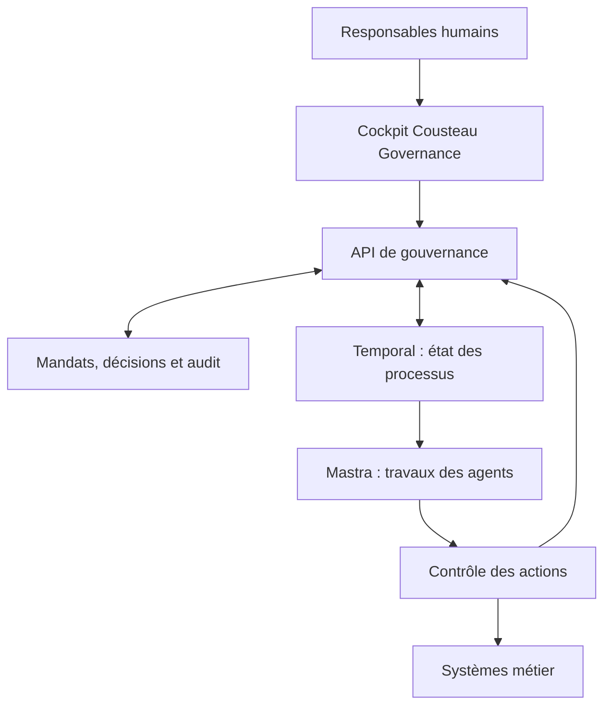

# Architecture de Cousteau Governance

Ce document distingue le démonstrateur livré de l’architecture cible. Les composants et interfaces de la cible sont des propositions de conception ; ils ne sont pas déployés dans cette version.

## 1. Responsabilité du produit

Cousteau Governance porte les décisions humaines : qui est responsable, quel mandat est accordé, quelles limites s’appliquent, qui tranche une exception et quelles preuves justifient le résultat. Le manager agit sur des objets métier reliés : organisation, objectif, mandat, processus, demande de décision et résultat.

Temporal et Mastra restent les choix d’exécution envisagés. La séparation proposée est explicite : **Temporal conserve le déroulement durable du processus ; Mastra réalise les travaux agentiques ; Cousteau Governance détient les mandats et les décisions humaines.**

## 2. Architecture livrée

| Sujet | Implémentation actuelle |
| --- | --- |
| Interface | HTML, CSS et modules JavaScript natifs, sans dépendance de rendu |
| Navigation | Fragments d’URL et rendu côté navigateur |
| État métier | Objet JavaScript et `localStorage` |
| Données initiales | Organisation fictive Northstar AM : 12 acteurs, 5 objectifs, 5 processus, 4 décisions initiales, 5 blocages, 6 règles |
| Exécution | Simulation synchrone dans `store.js`, sans outil ni modèle distant |
| Décisions | Mise à jour locale de la demande, du dossier simulé et du journal |
| Contrôles | Conditions prédéfinies : responsable, statut, autonomie, échéance, outils et budget |
| Audit | Liste locale exportable, modifiable et réinitialisable |
| Utilisateurs | Profil de démonstration ; aucun contrôle d’autorisation serveur |

Les mutations passent normalement par `update()`, qui clone l’état, applique la modification, ajoute une trace, persiste et notifie le rendu. Ce mécanisme améliore la cohérence des parcours ; il ne protège pas contre une modification directe du navigateur.

Une simulation crée un dossier et ses événements. Si une étape humaine, un pilote ou un niveau d’autonomie l’exige, elle crée une demande de décision. Une approbation ou un refus met à jour l’état du dossier concerné. Les simulations restent une représentation simplifiée du travail réel.

## 3. Sources de vérité de la cible

| Objet | Source de vérité proposée | Copies autorisées |
| --- | --- | --- |
| Identités et groupes humains | Fournisseur d’identité d’entreprise | Références et attributs nécessaires au contrôle |
| Organisation, responsabilités, mandats | Backend de gouvernance et base transactionnelle | Versions publiées vers les moteurs ; cache invalidable |
| Règles et versions de contrôle | Service de politiques gouverné | Versions embarquées pour évaluation, avec contrôle de fraîcheur |
| Demandes et décisions humaines | Backend de gouvernance | Projection dans l’historique du workflow et les interfaces |
| Progression du processus | Temporal | Projection dans le cockpit, datée et réconciliable |
| Travail d’un agent | Exécution Mastra et ses traces | Résultats, références de preuves et mesures nécessaires |
| Engagement dans un système métier | Système métier et reçu d’action | Référence transactionnelle, statut et preuve |
| Audit de gouvernance | Journal serveur avec protection d’intégrité | Index de recherche et exports autorisés |
| Objectifs et indicateurs | Gouvernance pour les objectifs ; sources métier définies pour les mesures | Calculs documentés avec provenance et date |

Une base relationnelle telle que PostgreSQL serait adaptée au référentiel de gouvernance ; ce choix reste à confirmer. Le cockpit ne doit pas inventer l’état d’un workflow ni transformer une estimation en résultat métier accepté.



Le contrôle des actions est une frontière serveur obligatoire pour les effets externes. Les identifiants d’accès aux systèmes métier restent hors du navigateur et hors du texte libre du modèle.

## 4. Répartition Temporal / Mastra

Temporal serait responsable du cycle de vie du dossier, des attentes, des échéances, des reprises et des transitions durables. Mastra serait appelé pour des travaux bornés : analyser un dossier, proposer un plan, préparer un document ou demander un outil.

Éviter deux orchestrateurs concurrents pour le même état métier : la fin d’une génération Mastra ne signifie pas que le dossier est terminé. L’acceptation d’un résultat, la décision humaine et l’effet externe sont des événements distincts. Leur corrélation doit conserver `organizationId`, `processId`, `workflowId`, `agentId` et les versions applicables.

## 5. Approbation liée à une action exacte

Dans la cible, la demande présente une action normalisée, son destinataire ou sa ressource, ses paramètres exacts, ses preuves, son échéance et la règle qui exige un arbitrage. L’empreinte proposée est un SHA-256 calculé sur une sérialisation canonique de ce contenu et des versions pertinentes ; une simple concaténation de texte ou un JSON dont l’ordre varie ne suffit pas.

Exemple de contrat cible, sans endpoint implémenté :

```json
{
  "schemaVersion": "1",
  "eventId": "evt-example-001",
  "eventType": "governance.decision.requested",
  "organizationId": "org-example",
  "processId": "process-example",
  "workflowId": "workflow-example",
  "decisionId": "decision-example",
  "actionId": "action-example",
  "agentId": "agent-example",
  "mandateVersion": 7,
  "policyVersion": "2026-11-04.1",
  "action": {
    "tool": "publish_internal_report",
    "resource": "report-example",
    "arguments": { "documentVersion": 3, "audience": "operations" }
  },
  "actionFingerprint": "sha256-of-canonical-action-and-context",
  "evidenceRefs": ["evidence-example"],
  "reviewerRole": "operations-reviewer",
  "expiresAt": "2026-11-05T17:00:00Z"
}
```

La réponse contient l’identifiant de décision, l’empreinte approuvée, l’issue, le motif, l’identité du valideur vérifiée côté serveur et la date. L’identité annoncée dans le corps de la requête ne fait jamais foi à elle seule.

Dans le démonstrateur, les nouvelles simulations utilisent une comparaison de contenu du mandat et des étapes. Ce n’est pas une signature cryptographique ni une garantie d’intégrité ; les demandes initiales sont des exemples préchargés.

## 6. Idempotence et concurrence

La décision est acceptée une seule fois pour une demande encore ouverte, via une transition atomique. Un nouvel envoi du même identifiant et du même contenu renvoie l’issue existante ; un contenu contradictoire est rejeté.

La décision et l’événement à transmettre doivent être enregistrés dans une même transaction, avec une boîte d’envoi transactionnelle (*outbox*) pour éviter de perdre une décision entre la base et le moteur. Temporal reçoit un identifiant stable ; le consommateur déduplique les messages. L’action métier possède aussi sa propre clé d’idempotence : dédupliquer une décision ne suffit pas à empêcher une double opération après une panne.

Avant l’effet externe, vérifier de nouveau l’action, les versions, l’autorité actuelle et la validité temporelle. Lorsque la ressource métier peut changer, utiliser sa version ou une précondition transactionnelle. Le contrôle de droits puis l’action doivent avoir une stratégie explicite contre la course entre révocation et engagement.

## 7. Révocation et arrêt

Une suspension ou une réduction de mandat invalide les autorisations concernées pour les prochaines actions. Elle déclenche un événement vers les exécutions actives et bloque leur reprise si nécessaire. Le système ne doit pas attendre la fin d’une génération pour empêcher un nouvel appel d’outil.

Une opération déjà engagée peut ne pas être annulable. L’interface doit distinguer « arrêt demandé », « nouvelles actions bloquées », « opération déjà engagée » et « arrêt confirmé ». Une compensation éventuelle est une action métier séparée, soumise à ses propres droits.

## 8. Rôles et audit

| Rôle cible | Responsabilité |
| --- | --- |
| Administrateur d’organisation | Gérer la structure et la configuration, sans s’attribuer automatiquement toutes les validations métier |
| Propriétaire de mandat | Définir et réviser la délégation dans son périmètre |
| Valideur métier | Accepter ou refuser les demandes correspondant à ses droits |
| Propriétaire de règle | Publier et versionner des contrôles après validation |
| Auditeur | Consulter les preuves et l’historique selon son périmètre |
| Agent technique | Demander et exécuter uniquement les actions autorisées à son identité |

L’audit cible relie auteur, rôle, action, ancienne et nouvelle version, motif, preuves, horodatage, identifiants de corrélation et reçu du système métier. Il doit être protégé contre la modification et soumis à une politique de conservation et d’accès. La séparation des rôles, l’isolation entre organisations et la protection des preuves sont à implémenter côté serveur.

## 9. Mesures et recommandations

Les recommandations de résolution de blocage doivent afficher leur preuve, leur hypothèse et leur niveau d’incertitude. Les coûts constatés, les coûts estimés, le temps humain de supervision et les bénéfices attendus restent séparés. L’acceptation d’un plan déclenche le suivi ; elle ne prouve pas son succès.

Les sources officielles à consulter lors de l’implémentation sont la [documentation Temporal](https://docs.temporal.io/encyclopedia/workflow-message-passing) et la [documentation Mastra sur les approbations](https://mastra.ai/docs/agents/human-in-the-loop). Le contrat doit être adapté aux versions effectivement retenues et testé de bout en bout.
